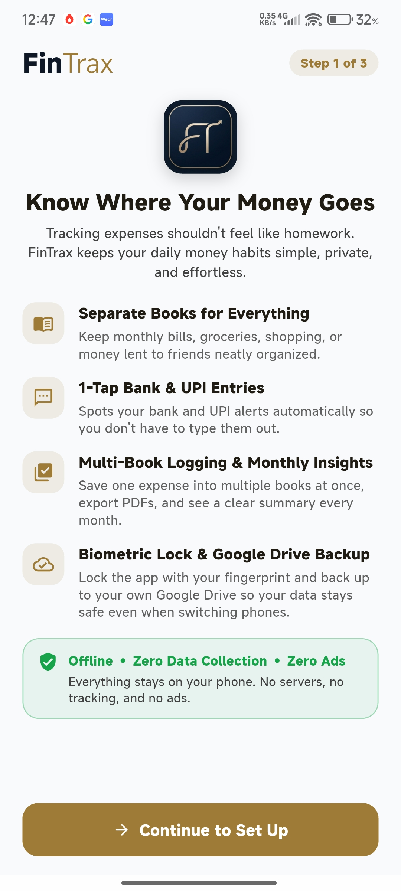
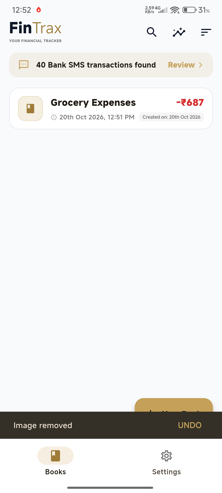
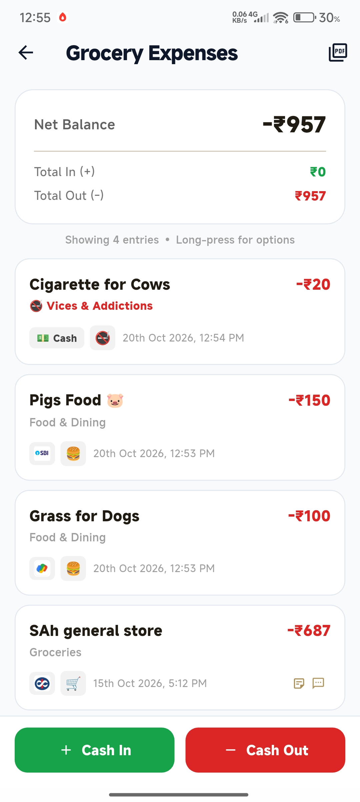
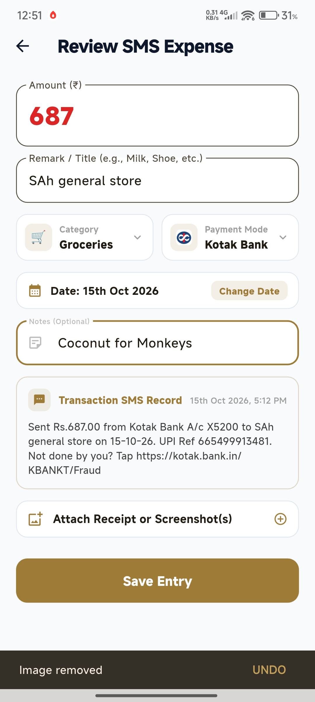
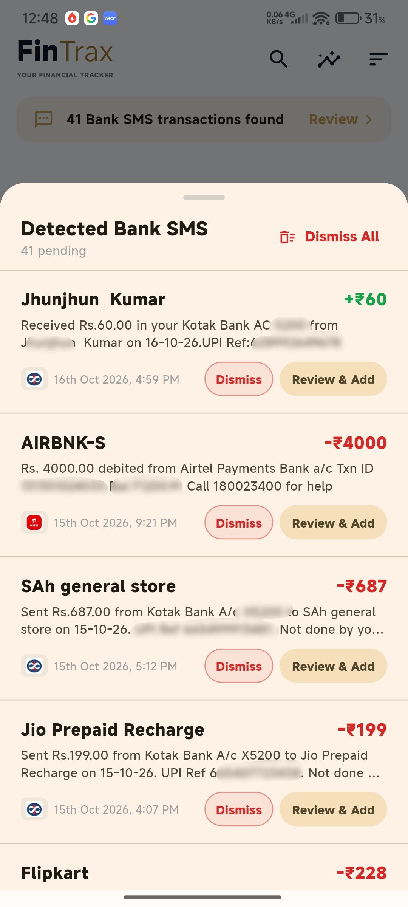
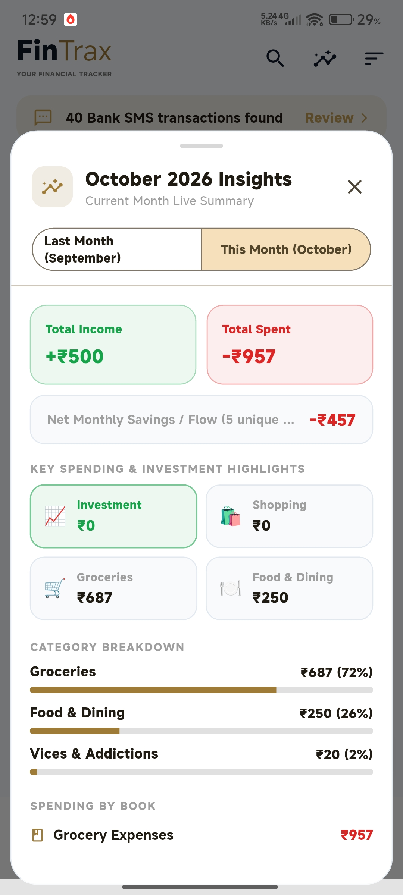
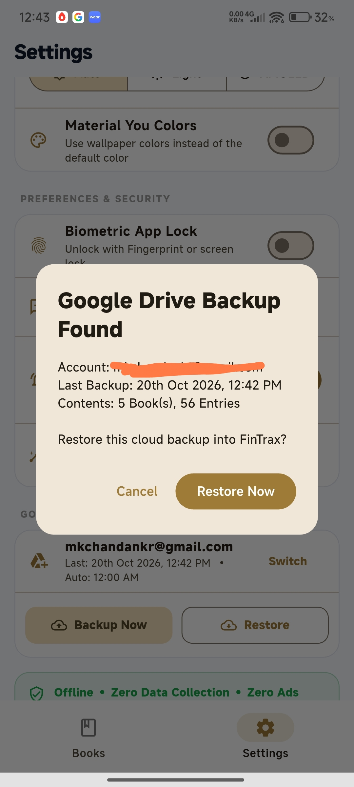
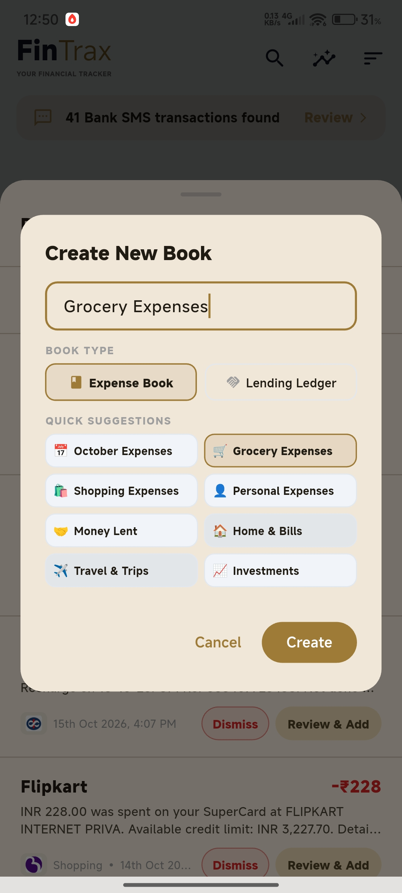
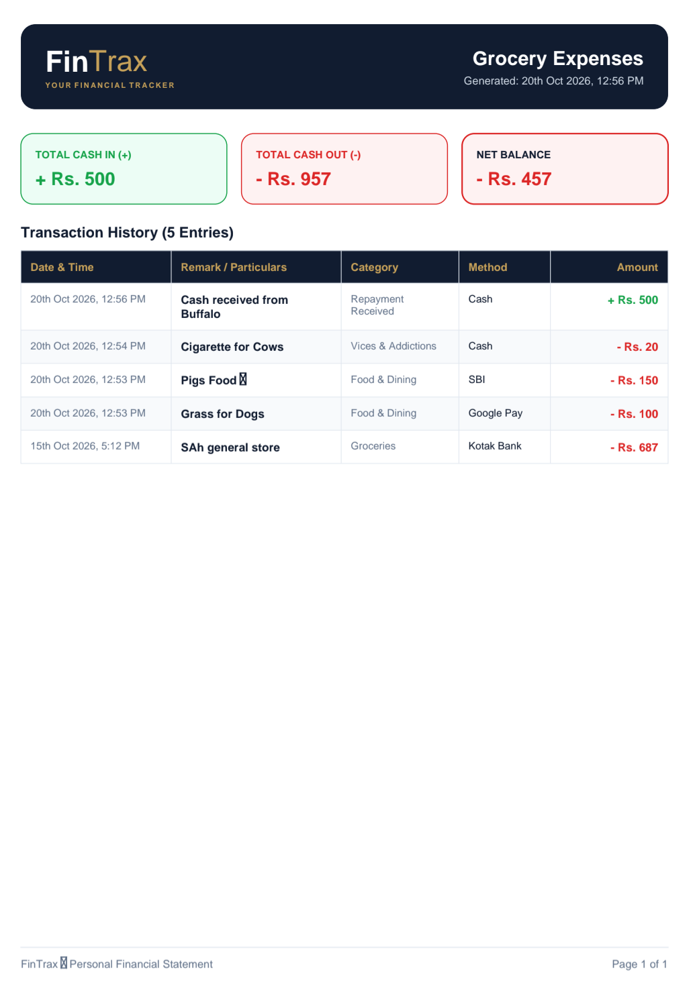

  
  <h1>FinTrax</h1>
  
<b>Your Friendly, Privacy-First Personal Finance Companion</b>

  
  
  
  

## 📱 About The Project

Tracking expenses shouldn't feel like a chore, and it definitely shouldn't require sacrificing your privacy. **FinTrax** is a beautifully designed, offline-first personal finance application built to keep your daily money habits simple, private, and effortless.

Unlike cloud-heavy financial apps, FinTrax runs **100% entirely on-device**. It intelligently parses bank and UPI SMS notifications locally without ever sending your messages to a server. 

### ✨ Key Features

*   **⚡ Smart On-Device SMS Detection:** Automatically spots bank debit/credit and UPI alerts. FinTrax extracts the merchant (e.g., Flipkart, Swiggy) and amount, preparing ready-to-save drafts in one tap. OTPs and personal chats are strictly ignored.
*   **🔒 100% Offline & Private:** Zero telemetry, zero trackers, and zero ads. Your financial data and SMS messages never leave your phone.
*   **☁️ Personal Google Drive Sync:** Backup and restore your database securely to your own Google Drive (`appDataFolder` scope), ensuring your data survives even if you switch devices.
*   **📚 Multi-Book & Lending Ledgers:** Create dedicated books for monthly expenses, trips, or groceries. Use specialized "Lending Ledgers" to track money lent to friends, complete with contact-book integration.
*   **🎨 Material You Design:** Fully adaptive UI with dynamic colors based on your wallpaper, featuring a clean AMOLED dark mode and glassmorphism elements.
*   **📊 Monthly Insights & PDF Exports:** Wake up on the 1st of every month to a detailed breakdown of your shopping, groceries, and investments. Generate and share clean PDF statements for any book.
*   **🛡️ Biometric Security:** Lock the app behind your device's native fingerprint or PIN authentication.

## 🛠️ Technical Architecture

*   **Framework:** Flutter (Dart)
*   **Local Storage:** SQLite (`sqflite`) for robust, offline-first relational data management.
*   **Native Integrations (MethodChannels):** Custom Kotlin native bridges for reading SMS inboxes securely, scheduling background alarms/notifications, and triggering biometric authentication.
*   **Authentication & Cloud:** `google_sign_in` and Google Drive API v3 for encrypted user-controlled backups.
*   **CI/CD:** Automated APK builds, artifact generation, and cryptographic signing using GitHub Actions.

## 📸 Screenshots

  
  
  
  

  
  
  
  

  

## 👨‍💻 About the Developer & 🚀 Open to Work

Hi, I'm **Chandan Kumar**. 

I am a highly driven professional with **4 years of experience** bridging the gap between operations, data analysis, and product development. I built FinTrax to solve a personal pain point, heavily utilizing my background in process automation, data structuring (VBA/Macros), and user-centric problem solving. 

I am deeply passionate about building tools that make people's lives easier and workflows more efficient. **I am actively seeking new opportunities** in Product Management, or Business Data Analysis where I can leverage my operational expertise and technical skills to build impactful products.

📫 **Let's Connect:**
*   **Email:** [mkchandankr@gmail.com](mailto:mkchandankr@gmail.com)
*   **Telegram:** [@chandsy](https://t.me/chandsy)
*   **GitHub:** [github.com/Chand5y](https://github.com/Chand5y)

